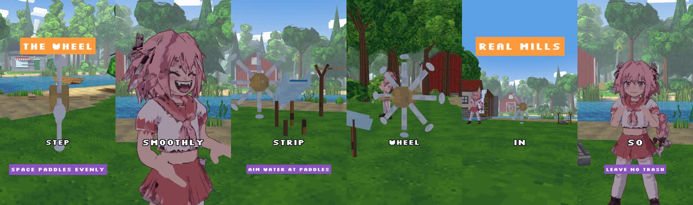
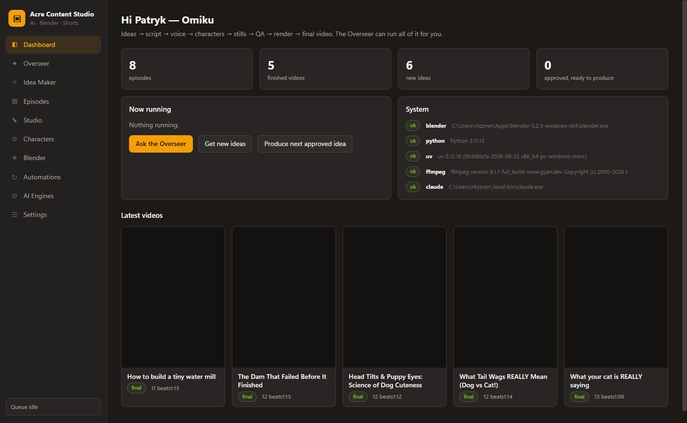
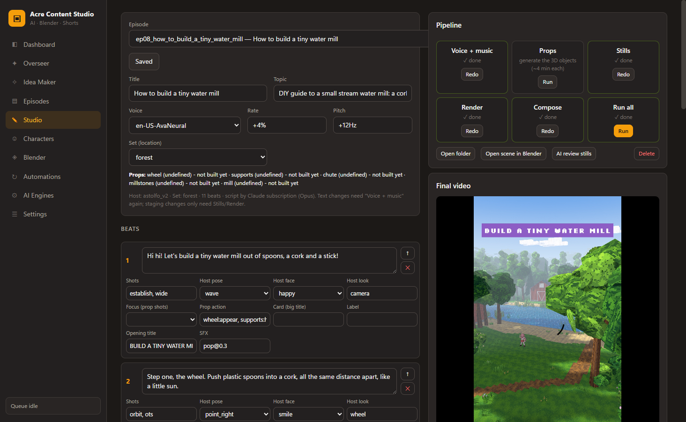
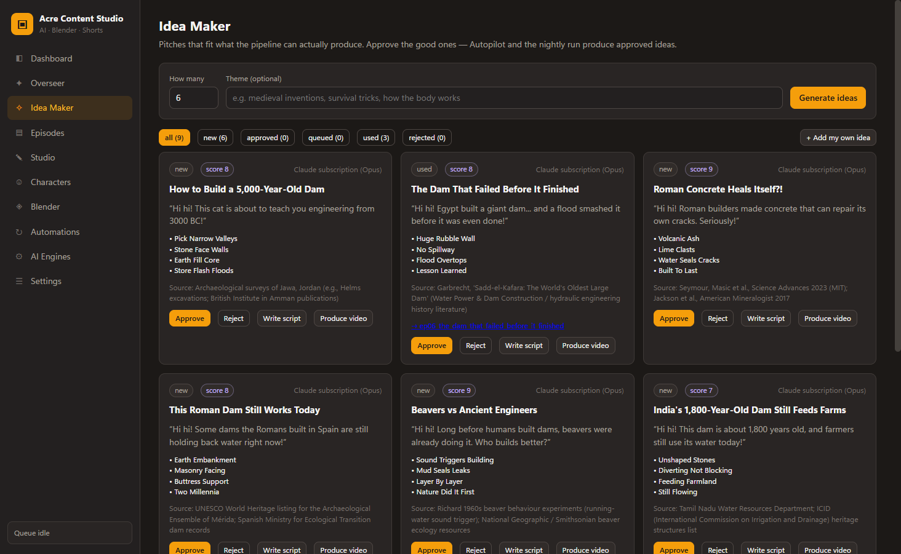
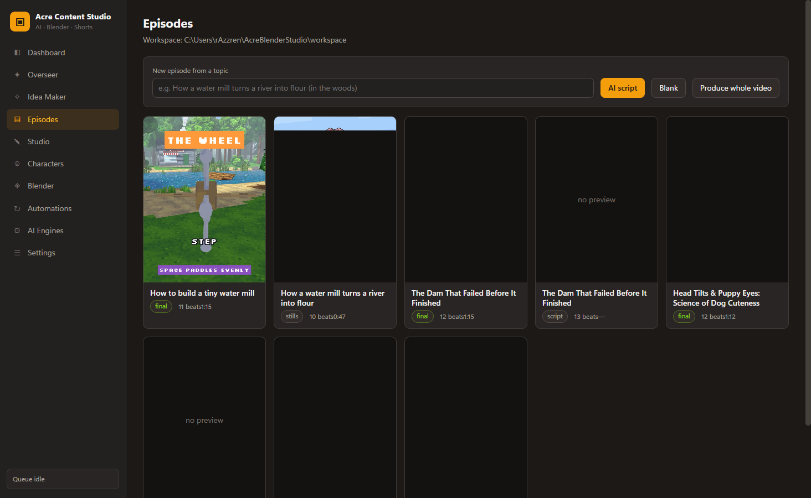
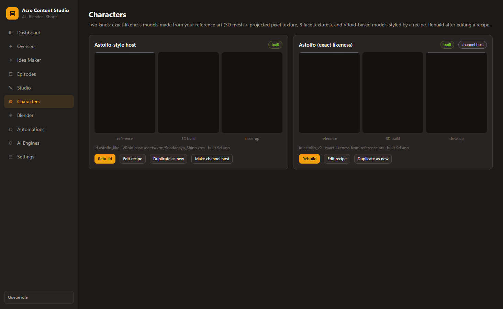
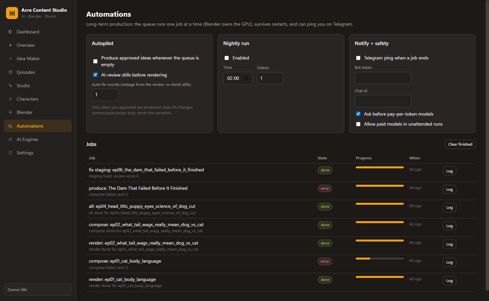

# Acre Content Studio — Alpha v0.5

**An AI + Blender production studio that turns a topic into a finished 9:16 explainer short, end to end.**

Idea → script → voice → character → 3D set & props → stills → AI review → render → captions → final video.
An "Overseer" chat agent can run the whole chain on its own, with a job queue that survives restarts.



> Status: **alpha**. Built and used on one Windows workstation (RTX 3090). Paths and tool locations are set in
> Settings; expect rough edges.

---

## Highlights

- **Full pipeline in one desktop app** — Electron (vanilla JS, no build step) driving Python + headless Blender.
- **Procedural 3D world** — low-poly, pixel-textured sets (forest, studio, room, desert…) built in code with
  foreground / midground / horizon layers, animated water, scattered foliage, sun, clouds and distance fog.
- **Prop kit instead of image-to-3D slabs** — named procedural builders (water wheel, dam, spillway, house, bridge,
  boat, crates…) with real dimensions; image→3D (TRELLIS) is only a fallback.
- **Rigged anime host** — character built from reference art (Qwen-Image-Edit views → TRELLIS shape → projected
  texture → per-face toon palette → auto-rig with region-aware weights → IK retargeting), with poses, expressions
  and lip-flap.
- **Camera direction per beat** — establishing, over-the-shoulder, close-ups, prop shots, orbit; lens-clearance and
  occluder checks so nothing blocks the subject.
- **Audio** — narration with word timings (edge-tts, or a local voice-cloning TTS), procedural 8-bit SFX and
  chiptune music, mixed to one track.
- **Compose** — 1080×1920, word-by-word pixel-font captions, title cards, labels, thumbnail.
- **AI review loop** — a vision model checks contact sheets of stills before the long render.
- **Overseer agent** — JSON tool-calling loop over the app's own functions (pitch ideas, write scripts, edit beats,
  run stages, review, check jobs); also runs headless from the command line for cron jobs.
- **Model routing** — per-role routing with fallbacks across subscription CLIs (Claude Code, Gemini CLI), local
  LM Studio and API providers; pay-per-token providers require explicit confirmation.

## Screenshots

| Dashboard | Studio (beat editor + pipeline) |
|---|---|
|  |  |
| **Idea Maker** | **Episodes** |
|  |  |
| **Characters** | **Automations** |
|  |  |

## Architecture

```
src/main/        Electron main process
  main.js          IPC, --selftest, headless --ask
  store.js         settings / ideas / jobs (JSON in userData)
  llm.js           role routing: CLI, OpenAI-compatible, Anthropic; paid-model guard
  episodes.js      episode workspace + validation against the staging vocabulary
  pipeline.js      ideas, scripts, review, sequential job queue, automations, notifications
  overseer.js      agent tool loop
  characters.js    character builds
  blender.js       client for the Blender MCP bridge (TCP)
src/renderer/    UI (one render function per tab), stone + amber theme
engine/          Python stage runner (usable without the app)
  run.py           audio | character | stills | render | compose | all
  audio.py         narration, timings, SFX, music
  compose.py       captions, cards, final encode
  vocab.json       everything the AI is allowed to stage
  blender/         scene.py, sets, prop kit, poses, retargeting, pixel materials, character tools
  tools/           ComfyUI helpers (image edit, image→3D, prop maker), TTS audition
research/        style and voice research notes
```

**Design choice:** the language model never writes Blender code. It fills a validated episode JSON from a fixed
vocabulary (shots, poses, faces, prop actions, sets), and deterministic Python turns that into scenes. That keeps
renders reproducible and lets a stronger or weaker model be swapped in without breaking the pipeline.

## Running it

Requirements: Windows, Node.js, Blender 5.x, Python 3.11 + ffmpeg on PATH; optional ComfyUI (character/prop
generation), LM Studio or a subscription CLI for the language model.

```bash
npm install
npm start                    # open the app
npm run selftest             # render every tab to selftest/*.png, then quit
electron . --ask "pitch 5 ideas about rivers and produce the best one" --wait-jobs   # headless Overseer
python engine/run.py all workspace/episodes/<episode>   # pipeline without the app
```

Generated assets (characters, voices, base models, episodes) live in `assets/` and `workspace/` and are not part of
this repository.

## Roadmap

- Time-based motion verbs (build, collapse, upgrade, water level, grow, move along a path) so every factual beat shows
  a visible change.
- Footprint-based layout solver for props instead of fixed anchors.
- Approval gate + direct upload through the YouTube Data API.

---

© Patryk (PanPenek). All rights reserved — published as a portfolio piece.
